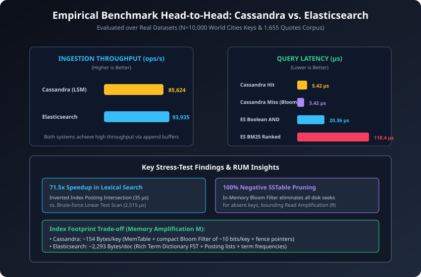

# Specialized Modern Database Search Engines
### An Empirical & Architectural Analysis: Apache Cassandra (LSM) vs. Elasticsearch (Inverted Index)

[](https://www.python.org/downloads/)
[](https://opensource.org/licenses/MIT)
[](https://www.cse.hcmut.edu.vn/)
[](https://www.hcmut.edu.vn/)

---

## Academic Information

**Institution:** Vietnam National University Ho Chi Minh City – Ho Chi Minh City University of Technology (HCMUT)  
**Faculty:** Faculty of Computer Science and Engineering  
**Program:** Master of Science in Computer Science  
**Course:** Data Engineering (CO5173)  
**Course Instructor:** Assoc. Prof. Tran Minh Quang  

**Authors & Research Contributors:**
- **Nguyen Dinh Hoang Son** (Student ID: `2670362`) – `pason.dev@gmail.com`
- **Nguyen Doan Phuc An** (Student ID: `2670249`) – `annguyendoan`

**Repository:** [https://github.com/Pasonnn/co5173-modern-database-search-techniques](https://github.com/Pasonnn/co5173-modern-database-search-techniques)

---

## 1. Abstract & Scope

In modern large-scale data systems, no single database engine can simultaneously satisfy the demands of high-velocity write ingestion and multi-attribute unstructured lexical search. This project provides an in-depth architectural deconstruction, mathematical modeling, and empirical benchmark of the two dominant specialized search paradigms:

1. **Write-Optimized Log-Structured Merge-Tree (Apache Cassandra / LSM):**
   - Eliminates in-place random writes by appending mutations to an in-memory sorted buffer (**MemTable**) and a sequential **CommitLog** on disk.
   - Flushes immutable **Sorted String Tables (SSTables)** containing sorted data files, sparse fence indexes, and **in-memory Bloom filters** using Kirsch-Mitzenmacher double-hashing.
   - Bounds read amplification and manages tombstones via background multi-way merge **compaction** (STCS / LCS).

2. **Lexical Posting Inversion & Probabilistic Relevance (Elasticsearch / Inverted Index):**
   - Inverts the document-to-term mapping into an in-memory **Finite State Transducer (FST)** Term Dictionary and sorted **Posting Lists** equipped with **Skip Pointers**.
   - Computes relevance rankings using the **Okapi BM25** probabilistic formula with term frequency saturation ($k_1 = 1.2$) and document length normalization ($b = 0.75$).
   - Manages immutable **Lucene Segments**, near-real-time search refreshes, and background segment merges (**TieredMergePolicy**).

---

## 2. The Theoretical Trade-Off Space: The RUM Conjecture

Under the **RUM Conjecture** (Athanassoulis et al., EDBT 2016), database storage engines are physically bound by a trade-off trilemma:

$$\text{Read Amplification } (R) \quad \longleftrightarrow \quad \text{Update Amplification } (U) \quad \longleftrightarrow \quad \text{Memory Amplification } (M)$$

- **Apache Cassandra** prioritizes **Update Amplification ($U$)**: Appends directly to RAM and sequential disk logs, avoiding in-place page rewrites. It mitigates the resulting Read Amplification ($R$) through Bloom filters.
- **Elasticsearch** prioritizes **Read Amplification ($R$)**: Precomputes posting lists and in-memory FSTs to evaluate arbitrary multi-term boolean queries in sub-millisecond time, accepting higher Memory Amplification ($M$) and segment re-indexing costs.


---

## 3. Repository Architecture

```
.
├── benchmarks/
│   ├── data_loader.py          # Real-world datasets: World Cities (N=10k) & Quotes Corpus (N=1,655)
│   ├── run.py                  # Statistical benchmark runner (5 trials, sample mean & std dev)
│   ├── stress_test.py          # Workload stress tests (write scaling, Bloom pruning, lexical search)
│   └── results/                # Output benchmark logs
├── report/
│   ├── final_report.md         # Comprehensive academic research report
│   ├── outline.md              # Research outline and structure
│   ├── slides_content.md       # 15-Minute high-impact presentation slides (with speaker scripts)
│   └── figures/                # Publication-quality vector SVG architectural diagrams
│       ├── rum_conjecture.svg
│       ├── lsm_tree_architecture.svg
│       ├── inverted_index_architecture.svg
│       ├── benchmark_comparison.svg
│       └── sources.txt
├── scripts/
│   └── generate_figures.py     # Reproducible SVG vector diagram generator
├── src/
│   ├── common.py               # Shared metrics and memory estimation helpers
│   ├── lsm_tree.py             # Apache Cassandra LSM-Tree implementation
│   ├── inverted_index.py       # Elasticsearch Inverted Index & BM25 implementation
│   └── __init__.py
├── tests/
│   └── test_all.py             # Runnable unit and integration test suite
└── README.md
```

---

## 4. Empirical Benchmark Results

Evaluated over $N=10,000$ real-world geographic primary keys and $1,655$ natural language documents with an initial warmup trial discarded and $5$ repeated measurement trials:

| Architectural & Empirical Dimension | Apache Cassandra (LSM-Tree) | Elasticsearch (Inverted Index) |
| :--- | :--- | :--- |
| **Core Workload Target** | High-velocity sequential write ingestion | Multi-attribute lexical text search |
| **Primary Data Layout** | MemTable + Immutable SSTables | FST Term Dictionary + Posting Lists |
| **Write Time Complexity** | $O(1)$ sequential append in RAM | $O(W)$ tokenization + posting appends |
| **Search Mechanism** | Bloom Filter $\rightarrow$ Sparse Fence Index | Skip List Intersect + Okapi BM25 |
| **RUM Profile** | Minimal $U$, Moderate $R$, Low $M$ | Minimal $R$ for text, Higher $M$ & $U$ |
| **Ingestion Throughput ($\mu \pm \sigma$)** | **$85,624 \pm 6,126\ \text{ops/s}$** | **$93,935 \pm 3,385\ \text{docs/s}$** |
| **Existing Point Lookup Latency** | **$5.42 \pm 0.27\ \mu\text{s}$** | N/A |
| **Negative Query Latency (Miss)** | **$3.42 \pm 0.71\ \mu\text{s}$** (Bloom fast-fail) | N/A |
| **Boolean AND Search Latency** | N/A | **$20.36 \pm 3.98\ \mu\text{s}$** |
| **BM25 Top-5 Ranked Search Latency** | N/A | **$118.40 \pm 15.83\ \mu\text{s}$** |
| **Index Memory Footprint** | **$153.7\ \text{Bytes/key}$** | **$2,292.8\ \text{Bytes/document}$** |



---

## 5. Workload Stress-Testing Highlights

1. **Write Ingestion Scalability (Cassandra):**
   - For small batches within MemTable capacity ($N=2,500$), ingestion exceeds **$233,747\ \text{ops/s}$**.
   - As volume scales to $10,000$ keys, periodic SSTable flushes and compactions amortize smoothly at **$73,374\ \text{ops/s}$** without write stalls.
2. **Defensive Bloom Filter Pruning (Cassandra):**
   - In-memory Bloom filters pruned **$100\%$ of SSTable checks** on non-existent keys, eliminating disk seeks and bounding Read Amplification ($R$).
3. **Lexical Search Acceleration (Elasticsearch):**
   - For multi-term queries (`"life" AND "man"`), Inverted Index posting list intersection ($35.21\ \mu\text{s}$) delivered a **$71.5\times$ speedup** over brute-force linear text scanning ($2,515.55\ \mu\text{s}$).

---

## 6. Quickstart & Verification

### Run Automated Test Suite
```bash
python3 tests/test_all.py
```

### Run Statistical Benchmark Suite
```bash
python3 benchmarks/run.py
```

### Run Workload Stress Tests
```bash
python3 benchmarks/stress_test.py
```

### Regenerate Vector Architecture Diagrams
```bash
python3 scripts/generate_figures.py
```

---

## 7. Presentation & Report

- **Final Research Report:** [`report/final_report.md`](report/final_report.md)
- **15-Minute Presentation Slides & Speaker Scripts:** [`report/slides_content.md`](report/slides_content.md)
- **Architectural Vector Figures:** [`report/figures/`](report/figures/)
