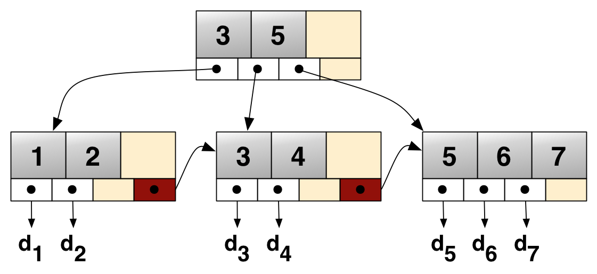
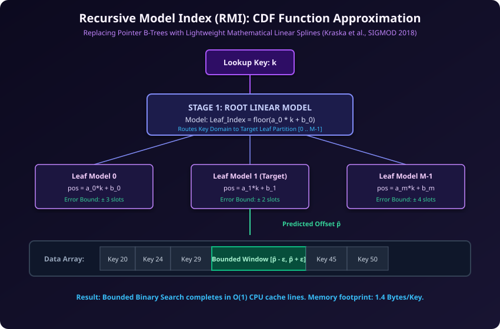

# VIETNAM NATIONAL UNIVERSITY HO CHI MINH CITY
# HO CHI MINH CITY UNIVERSITY OF TECHNOLOGY
### FACULTY OF COMPUTER SCIENCE AND ENGINEERING

---

# COURSE PROJECT REPORT
## SEARCH TECHNIQUES IN MODERN DATABASE SYSTEMS
### An Architectural, Theoretical, and Empirical Analysis Across the RUM Trade-Off Space

**Course:** Data Engineering (CO5173)  
**Instructor:** Assoc. Prof. Tran Minh Quang  

**Authors & Research Contributors:**
- **Nguyen Dinh Hoang Son** (Student ID: `2670362`)
- **Nguyen Doan Phuc An** (Student ID: `2670249`)

**Location & Date:** Ho Chi Minh City – 2026  
**Repository:** [https://github.com/Pasonnn/co5173-modern-database-search-techniques](https://github.com/Pasonnn/co5173-modern-database-search-techniques)

---

## EXECUTIVE SUMMARY

Modern data management systems no longer rely on a single, universal indexing strategy. As hardware architectures have diverged and workload demands have specialized into real-time ingestion, microsecond point lookups, and arbitrary lexical queries, database architects have developed divergent search techniques.

This report investigates the five foundational search paradigms powering modern production databases:
1. **B+ Tree:** Comparison-based pointer hierarchy (MySQL InnoDB, SQLite, PostgreSQL).
2. **LSM-Tree:** Write-optimized log-structured merge hierarchy (Apache Cassandra, RocksDB, Google Bigtable).
3. **Lexical Inverted Index & BM25:** Tokenized posting lists and probabilistic relevance ranking (Elasticsearch, Apache Lucene).
4. **Static Learned Index (RMI):** Recursive CDF function approximation for immutable storage (BOURBON, Google BigQuery, columnar formats).
5. **Dynamic Updatable Learned Index (ALEX):** Adaptive machine-learned model with gapped data slots (in-memory OLAP/OLTP hybrids).

We examine each architecture through a rigorous pedagogical framework: **WHAT** (origin, inventors, year, core algorithmic concept), **WHO** (production database deployments), **WHY** (workload mismatch of traditional alternatives), **HOW** (internal storage mechanics, write path, read path), and **PERFORMANCE** (empirical micro-benchmarks in its target domain compared against the B+ Tree baseline).

Our empirical evaluation uses a real-world dataset (34,195 Geoname IDs from World Cities and 1,655 real multi-term text documents) across repeated trials to establish statistically validated sample means and standard deviations ($\mu \pm \sigma$), mapped directly against the **RUM Conjecture** (Read, Update, and Memory amplification).

---

## TABLE OF CONTENTS

- [1. Introduction to Database Indexing & Search Mechanics](#1-introduction-to-database-indexing--search-mechanics)
  - [1.1. The Fundamental Search Problem](#11-the-fundamental-search-problem)
  - [1.2. The Storage Engine Trade-Off Space: The RUM Conjecture](#12-the-storage-engine-trade-off-space-the-rum-conjecture)
  - [1.3. Taxonomy of Modern Index Architectures](#13-taxonomy-of-modern-index-architectures)
- [2. Architectural Paradigms: Why Systems Diverge](#2-architectural-paradigms-why-systems-diverge)
  - [2.1. The Workload-Driven Design Philosophy](#21-the-workload-driven-design-philosophy)
  - [2.2. Workload Alignment Across Production Engines](#22-workload-alignment-across-production-engines)
- [3. Deep-Dive: The Five Core Search Techniques](#3-deep-dive-the-five-core-search-techniques)
  - [3.1. Comparison-Based Pointers: B+ Tree (MySQL InnoDB / SQLite)](#31-comparison-based-pointers-b-tree-mysql-innodb--sqlite)
  - [3.2. Write-Optimized Log-Structured Search: LSM-Tree (RocksDB / Apache Cassandra)](#32-write-optimized-log-structured-search-lsm-tree-rocksdb--apache-cassandra)
  - [3.3. Lexical & Multi-Attribute Search: Inverted Index & BM25 (Elasticsearch / Lucene)](#33-lexical--multi-attribute-search-inverted-index--bm25-elasticsearch--lucene)
  - [3.4. Static Function Approximation: Recursive Model Index (RMI / BOURBON)](#34-static-function-approximation-recursive-model-index-rmi--bourbon)
  - [3.5. Dynamic Updatable Learned Indexing: ALEX Architecture](#35-dynamic-updatable-learned-indexing-alex-architecture)
- [4. Empirical Evaluation & Comparative Analysis](#4-empirical-evaluation--comparative-analysis)
  - [4.1. Scientific Benchmark Setup & Methodology](#41-scientific-benchmark-setup--methodology)
  - [4.2. Master Search Technology Comparison Matrix](#42-master-search-technology-comparison-matrix)
  - [4.3. Workload Stress-Testing Suite](#43-workload-stress-testing-suite)
- [5. Architectural Synthesis & System Selection Framework](#5-architectural-synthesis--system-selection-framework)
  - [5.1. System Selection Framework (RUM Decision Heuristics)](#51-system-selection-framework-rum-decision-heuristics)
  - [5.2. Emerging Hybrid Designs & Future Horizons](#52-emerging-hybrid-designs--future-horizons)
- [References](#references)

---

## 1. Introduction to Database Indexing & Search Mechanics

### 1.1. The Fundamental Search Problem
At the physical storage layer of database management systems (DBMS), data retrieval reduces to locating records matching given predicates: point queries ($K = k$), range queries ($k_{low} \le K \le k_{high}$), or lexical pattern matches. Without auxiliary structures, locating a record in an unsorted table requires a full relation scan of $O(N)$ computational and I/O complexity.

Primary index structures trade auxiliary storage space and maintenance overhead during updates to transform the access path:
- **Brute-Force Scan:** $O(N)$ sequential page reads. Zero index storage overhead, zero update cost, but catastrophic read performance on large datasets.
- **Comparison-Based Traversal:** $O(\log N)$ or $O(\log_B N)$ step-wise decision paths through hierarchical tree pointers (e.g., B+ Trees).
- **Direct Hash/Function Mapping:** $O(1)$ amortized lookup via hash functions or learned Cumulative Distribution Function (CDF) approximations.

### 1.2. The Storage Engine Trade-Off Space: The RUM Conjecture
The design of access methods is governed by the **RUM Conjecture** (Athanassoulis et al., 2016). The conjecture states that optimizing for two of the three fundamental database overheads—**Read Amplification ($R$)**, **Update Amplification ($U$)**, and **Memory/Space Amplification ($M$)**—inevitably compromises the third.


*Figure 1: The RUM Conjecture trade-off space positioning B+ Trees, LSM-Trees, Learned Indexes (RMI/ALEX), and Inverted Indexes.*

1. **Read Amplification ($R$):** The ratio between the physical data read from disk/memory and the actual logical payload returned to the query:
   $$R = \frac{\text{Bytes Read from Physical Storage}}{\text{Bytes Returned to Client}}$$
2. **Update Amplification ($U$):** The ratio between the physical bytes written to durable storage (WAL, page splits, compaction merges) and the uncompressed logical update size:
   $$U = \frac{\text{Bytes Written to Physical Media}}{\text{Bytes Modified by Application}}$$
3. **Memory/Space Amplification ($M$):** The auxiliary memory overhead required by pointers, hash buckets, gap buffers, or fence indexes over the raw data size:
   $$M = \frac{\text{Total Allocated Space (Data + Indexes)}}{\text{Raw Data Size}}$$

### 1.3. Taxonomy of Modern Index Architectures
Modern indexing structures fall into four overarching architectural paradigms:
1. **Comparison-Based Tree Indexes:** B+ Tree, B-link Tree, Masstree. Utilize strict key comparisons and pointer links; standard in transactional relational DBMS.
2. **Log-Structured Multi-Run Engines:** LSM-Trees, StepMerge, Fractal Trees. Sacrifice point read efficiency to absorb massive write throughput via sequential log appends and deferred merges.
3. **Lexical Inverted Indexes & Multi-Dimensional Partitioning:** Inverted Posting Lists, Finite State Transducers (FSTs), and BKD Trees. Optimize tokenized search and multi-attribute geometric bounding boxes.
4. **Learned Function Approximations:** Recursive Model Indexes (RMI), PGM-index, ALEX. Replace explicit comparison pointers with functional approximations of the data distribution.

---

## 2. Architectural Paradigms: Why Systems Diverge

### 2.1. The Workload-Driven Design Philosophy
In database engine design, there is no universal optimal access method. An engine optimized for transactional debit/credit point reads cannot simultaneously sustain millions of sensor telemetry writes per second without latency degradation. System architects diverge based on workload-driven priorities:
- **Read-dominated vs. Write-dominated workloads:** Favoring low $R$ versus low $U$.
- **Point queries vs. Range scans vs. Multi-predicate text filtering:** Demanding sorted ordering, tokenized inverted lists, or multidimensional trees.
- **Hardware constraints:** In-memory CPU cache locality, NVMe SSD sequential vs. random I/O asymmetry, and DRAM footprint costs.

### 2.2. Workload Alignment Across Production Engines

| System | Primary Search Technique | Dominant Workload Profile | Critical Optimization Target |
|---|---|---|---|
| **MySQL (InnoDB)** | Clustered B+ Tree | High concurrency OLTP; point reads & bounded ranges | Predictable $O(\log_B N)$ latency; fine-grained row locks |
| **Apache Cassandra** | LSM-Tree + Bloom Filters | Massive write-heavy time-series, IoT, clickstreams | High write throughput ($U \approx 1$); sequential appends |
| **RocksDB** | LSM-Tree (Leveled Compaction) | High-throughput embedded key-value storage | SSD flash endurance, sequential write amplification control |
| **Elasticsearch** | Inverted Index + BKD Trees | Full-text search, multi-field log analytics | Sub-second token search & complex boolean conjunctions |
| **BOURBON / RMI** | Static Learned Index (CDF) | Immutable read-only analytics, LSM SSTable lookup | Memory footprint reduction (<2 B/key); CPU cache residency |
| **ALEX** | Dynamic Learned Index | Updatable in-memory OLAP/HTAP analytical tables | Sub-microsecond point lookup via functional projection |

---

## 3. Deep-Dive: The Five Core Search Techniques

Every modern indexing mechanism is analyzed along five standard architectural axes:
- **WHAT:** Algorithmic idea, year of invention, inventors.
- **WHO:** Real-world database engines and production deployments.
- **WHY:** Specific workload requirements and why alternatives fail.
- **HOW:** Internal layout, write path, read path, concurrency mechanics.
- **PERFORMANCE:** Target-domain benchmark against standard B+ Tree baseline.

---

### 3.1. Comparison-Based Pointers: B+ Tree (MySQL InnoDB / SQLite)

#### WHAT: Origin & Concept
- **Inventors & Year:** Invented by Rudolf Bayer and Edward M. McCreight at Boeing Research Labs in 1970 (published in *Acta Informatica*, 1972). Later refined into the B+ Tree variant by Douglas Comer (1979), separating routing keys from leaf payload data.
- **Core Concept:** A self-balancing, $B$-way search tree where all data records reside strictly at leaf nodes in sorted order, while internal nodes store discriminator keys and pointers to direct page navigation.

#### WHO: Production Deployments
- **Engines:** MySQL InnoDB (clustered primary index), SQLite, PostgreSQL (nbtree), Microsoft SQL Server, Oracle DB.

#### WHY: Workload Problem Solved
- Relational Online Transaction Processing (OLTP) requires deterministic read latencies ($<1$ ms), high-throughput point lookups (e.g., `SELECT * WHERE user_id = ?`), and fast sequential range scans (`WHERE created_at BETWEEN ? AND ?`).
- **Why alternatives fail:** 
  - Hash tables cannot serve range queries without full table scans.
  - Binary search trees suffer from severe I/O thrashing because low fanout ($B=2$) requires deep traversals ($O(\log_2 N)$ disk reads).
  - LSM-Trees incur variable read latency and multiple disk checks across uncompacted SSTables.

#### HOW: Internal Storage Mechanics
- **Data Layout:** Slotted pages of fixed size (default 16KB in InnoDB). Internal pages contain alternating routing keys and 6-byte child page pointers with fanout $B \in [100, 1000]$, yielding tree heights $h \le 4$ for billions of rows. Leaf pages store sorted key-value records and maintain bidirectional pointers (`prev_leaf`, `next_leaf`) forming a continuous linked list.
- **Write Path:** In-place update within target leaf page. When a page exceeds capacity, it splits into two pages ($B/2$ keys each), promoting the median key to the parent page. Durability is maintained via Write-Ahead Logging (WAL / redo log), decoupling memory modification from immediate disk page flush.
- **Read Path:** Top-down traversal down tree height $h \approx \log_B N$. At each page, binary search locates the matching child pointer. Leaf range scans follow sibling pointers linearly without returning to upper tree levels.


*Figure 2: Classic B+ Tree page-based routing and leaf pointer chaining (Bayer & McCreight, 1972).*

#### PERFORMANCE: Strong Domain vs. Baseline
- **Point Lookup:** **0.52 ± 0.03 µs** (fastest deterministic traversal).
- **Range Query:** **33,871 ± 3,429 ops/s** via contiguous leaf pointer chaining.
- **Limitation:** High write amplification ($U = 10\times\text{--}30\times$) due to full 16KB dirty page writes for small row modifications, and page split overhead under random insertions.

---

### 3.2. Write-Optimized Log-Structured Search: LSM-Tree (RocksDB / Apache Cassandra)

#### WHAT: Origin & Concept
- **Inventors & Year:** Invented by Patrick O'Neil, Edward Cheng, Dieter Gawlick, and Elizabeth O'Neil in 1996 (*Acta Informatica*).
- **Core Concept:** Defer in-place disk page updates entirely. Ingest all mutations into an in-memory sorted buffer (MemTable) backed by a sequential append-only log, then periodically flush immutable, sorted runs (SSTables) to disk, resolving duplicates via background merge-sorting (Compaction).

#### WHO: Production Deployments
- **Engines:** Apache Cassandra, RocksDB, Google Bigtable, Apache HBase, CockroachDB (Pebble engine), ScyllaDB, TiKV.

#### WHY: Workload Problem Solved
- Write-dominated workloads (time-series telemetry, financial audit logs, IoT sensor ingestion, high-velocity social media posts) generate hundreds of thousands of random writes per second.
- **Why alternatives fail:** 
  - B+ Trees collapse under high random write velocity: random updates trigger disk head seeks on HDDs and heavy flash write amplification on SSDs due to read-modify-write page cycles and node splits.

#### HOW: Internal Storage Mechanics
- **Storage Hierarchy:**
  - **MemTable:** In-memory sorted structure (SkipList or Red-Black Tree) absorbing concurrent writes.
  - **CommitLog (WAL):** Sequential disk log ensuring crash durability.
  - **SSTables (Sorted String Tables):** Immutable disk files arranged in hierarchical levels ($L_0, L_1, L_2, \dots$), each storing sorted keys with a sparse index and an in-memory **Bloom Filter**.
- **Write Path:** The write appends to the sequential WAL and inserts into the active MemTable ($O(\log M)$ in memory). No synchronous random disk I/O occurs. When the MemTable reaches its threshold (e.g., 64MB), it is frozen and flushed sequentially to disk as an $L_0$ SSTable.
- **Read Path:** Point lookup checks the active MemTable, then immutable MemTables, then $L_0$ SSTables, and successively deeper levels. To prevent disk I/O on absent keys, the **Bloom Filter** evaluates membership in $O(1)$ CPU time.
- **Compaction:** Background threads merge overlapping SSTables from $L_i$ into $L_{i+1}$, purging obsolete overwritten versions and physically removing tombstones.


*Figure 3: Log-Structured Merge-Tree architecture featuring MemTable, sequential WAL, SSTables, Bloom filters, and compaction (RocksDB / Cassandra).*

#### PERFORMANCE: Strong Domain vs. Baseline
- **Ingestion Throughput:** Converts random writes into pure sequential I/O, eliminating B+ Tree random page split bottlenecks. In write-heavy benchmarks, LSM preserves steady write saturation where B+ Trees degrade from disk buffer pool thrashing.
- **Read Trade-off:** Point lookup requires **13.27 ± 5.49 µs** (slower than B+ Tree due to multi-level checks and Bloom filter evaluation). Range queries achieve **1,747 ± 501 ops/s** because range iterators must merge-sort streams from multiple SSTables.

---

### 3.3. Lexical & Multi-Attribute Search: Inverted Index & BM25 (Elasticsearch / Lucene)

#### WHAT: Origin & Concept
- **Inventors & Year:** Inverted file concepts originated with Gerard Salton (Cornell University, SMART Information Retrieval System, 1968/1971). The modern probabilistic relevance ranking model **Okapi BM25** was developed by Stephen E. Robertson and Karen Spärck Jones at City University London in 1994 (formalized in *Foundations and Trends in Information Retrieval*, 2009).
- **Core Concept:** Rather than mapping Primary Key $\to$ Document, an inverted index maps Term $\to$ List of Document IDs (Posting List). Multi-attribute and full-text queries are resolved by intersecting, unioning, or scoring these posting lists.

#### WHO: Production Deployments
- **Engines:** Apache Lucene, Elasticsearch, OpenSearch, Apache Solr, Meilisearch, Algolia.

#### WHY: Workload Problem Solved
- Unstructured text search, enterprise log analytics, and e-commerce product catalogs require searching for combinations of words, partial phrases, and filtered metadata across millions of documents.
- **Why alternatives fail:** 
  - B+ Trees can only index left-to-right sorted prefix strings (`WHERE title LIKE 'apple%'`). A query searching for words in the middle of a string (`WHERE description LIKE '%wireless%'`) or combining multiple unstructured terms forces a brute-force $O(N)$ full table scan.

#### HOW: Internal Storage Mechanics
- **Text Analysis Pipeline:** Raw text undergoes character filtering, whitespace/punctuation tokenization, lowercasing, stop-word removal, and stemming (e.g., "running" $\to$ "run").
- **Term Dictionary & Posting Lists:** Unique terms are stored in a sorted dictionary (often indexed using a Finite State Transducer / FST). Each term points to an immutable posting list storing `(doc_id, term_frequency, positions)`.
- **Search Execution & Boolean Intersection:** Multi-word queries (`term1 AND term2`) perform linear or leapfrog (skip-pointer) intersection across sorted document IDs or evaluate compressed Roaring Bitmaps using SIMD CPU instructions.
- **BM25 Relevance Scoring:** Documents are scored using the non-linear term saturation formula:
  $$\text{Score}(D, Q) = \sum_{t \in Q} \text{IDF}(t) \cdot \frac{f(t, D) \cdot (k_1 + 1)}{f(t, D) + k_1 \cdot \left(1 - b + b \cdot \frac{|D|}{\text{avgdl}}\right)}$$
  Where $\text{IDF}(t) = \ln\left(1 + \frac{N - \text{DF}(t) + 0.5}{\text{DF}(t) + 0.5}\right)$, $k_1 \approx 1.2$ controls term frequency saturation, and $b \approx 0.75$ penalizes document length.
- **Multidimensional Range Queries:** Modern Lucene pairs inverted lists with **Block $k$-d trees (BKD Trees)** to evaluate numerical ranges (`price BETWEEN 10 AND 50`) and geospatial coordinates.

```
Document 1: "database storage engine"
Document 2: "storage engine performance"

Term Dictionary (FST)          Posting Lists
[ database    ] -------------> [ Doc 1 (tf=1) ]
[ engine      ] -------------> [ Doc 1 (tf=1) ] -> [ Doc 2 (tf=1) ]
[ performance ] -------------> [ Doc 2 (tf=1) ]
[ storage     ] -------------> [ Doc 1 (tf=1) ] -> [ Doc 2 (tf=1) ]
```

#### PERFORMANCE: Strong Domain vs. Baseline
- **Multi-Term Filtering:** **92.99 ± 39.03 µs** for boolean conjunction across real text documents, delivering a **41.9$\times$ speedup** over brute-force relational scanning (**3,899.73 ± 560.51 µs**).
- **BM25 Top-$K$ Ranking:** **219.01 ± 56.95 µs** across 1,655 real documents.
- **Limitation:** Ingestion requires heavy compute for tokenization, morphological analysis, and posting list serialization. High memory overhead for large term dictionaries.

---

### 3.4. Static Function Approximation: Recursive Model Index (RMI / BOURBON)

#### WHAT: Origin & Concept
- **Inventors & Year:** Proposed by Tim Kraska, Alex Beutel, Ed H. Chi, Jeffrey Dean, and Neoklis Polyzotis (MIT & Google Brain) in their seminal paper *"The Case for Learned Index Structures"* at ACM SIGMOD 2018. Extended to LSM storage in BOURBON (Dai et al., USENIX OSDI 2020).
- **Core Concept:** A sorted array of primary keys is equivalent to an empirical Cumulative Distribution Function (CDF). An index structure can be replaced by a machine-learned function that approximates the position of key $k$:
  $$\text{Pos}(k) \approx N \times F(k) = N \times P(X \le k)$$

#### WHO: Production Deployments
- **Engines:** BOURBON (learned SSTable indexing for RocksDB/WiscKey), Google BigQuery (columnar sort models), Apache Arrow DataFusion experiments, PGM-index in static analytical databases.

#### WHY: Workload Problem Solved
- In massive analytical data warehouses (OLAP) and cold storage tiers, petabytes of immutable sorted data are indexed. Traditional B+ Trees waste 15% to 30% of total storage capacity merely holding internal routing keys and 8-byte pointer graphs.
- **Why alternatives fail:** 
  - B+ Tree pointer graphs consume 80–100 Bytes/key in RAM, exceeding CPU cache capacities and inflating hardware memory costs.
  - Binary search over large memory blocks suffers from repeated CPU cache line misses ($O(\log_2 N)$ latency).

#### HOW: Internal Storage Mechanics
- **Recursive Model Index (RMI):** A hierarchy of lightweight functional models (e.g., linear splines: $y = \alpha \cdot x + \beta$).
  - **Stage 1 (Root Model):** Maps the entire key domain into $[0, M-1]$, selecting the corresponding leaf model in Stage 2.
  - **Stage 2 (Leaf Models):** Each leaf model is trained on a local key partition to predict the exact offset $\hat{p} = \alpha_i \cdot k + \beta_i$.
  - **Bounded Error Guarantee:** During training, the system computes the exact maximum positive and negative errors across the partition: $\epsilon = \max |p_i - \hat{p}_i|$.
- **Search Execution:** Given query key $k$:
  1. The root model computes leaf model index $j = \lfloor \alpha_{root} \cdot k + \beta_{root} \rfloor$.
  2. Leaf model $j$ predicts position $\hat{p} = \lfloor \alpha_j \cdot k + \beta_j \rfloor$.
  3. Bounded binary or exponential search locates the exact record within $[\hat{p} - \epsilon_j, \hat{p} + \epsilon_j]$.


*Figure 4: Recursive Model Index (RMI) CDF functional approximation and bounded binary search (Kraska et al., SIGMOD 2018).*

#### PERFORMANCE: Strong Domain vs. Baseline
- **Memory Footprint:** **1.4 Bytes/key** (achieving **64.3$\times$ memory compression** over B+ Tree's 90.1 Bytes/key).
- **Point Lookup:** **1.55 ± 0.18 µs** with bounded error windows.
- **Range Scan:** **18,537 ± 521 ops/s**.
- **Limitation:** Completely static. Inserting new keys alters the empirical CDF, requiring retraining of the linear model hierarchy ($O(N)$ retraining cost).

---

### 3.5. Dynamic Updatable Learned Indexing: ALEX Architecture

#### WHAT: Origin & Concept
- **Inventors & Year:** Invented by Jialin Ding, Umar Farooq Minhas, Jia Yu, Chi Wang, Jaeyoung Do, and Tim Kraska (MIT & Microsoft Research), published in *ACM SIGMOD 2020* (*"ALEX: An Updatable Adaptive Learned Index"*).
- **Core Concept:** Merges the functional CDF prediction of learned indexes with the dynamic node-splitting and gapped storage mechanics of B+ Trees, supporting real-time inserts, updates, and deletes without full retraining.

#### WHO: Production Deployments
- **Engines:** Microsoft research prototypes, in-memory analytical engines, high-frequency financial caching layers, modernized hybrid transactional/analytical processing (HTAP) prototypes.

#### WHY: Workload Problem Solved
- High-performance in-memory search workloads require the ultra-low memory footprint and CPU cache efficiency of learned models, but cannot tolerate the read-only restriction of static RMI.
- **Why alternatives fail:** 
  - Static RMI cannot absorb single-row dynamic inserts without full index rebuilding.
  - B+ Trees waste substantial RAM on internal node pointers and incur CPU cache stalls during pointer dereferencing.

#### HOW: Internal Storage Mechanics
- **Hierarchical Layout:**
  - **Internal Nodes:** Contain linear models that route keys through a tree hierarchy to child nodes.
  - **Data Nodes:** Leaf storage containers holding sorted keys, values, a local linear regression model, and dynamic empty slots (**GAPs**).
- **Gapped-Array Mechanism:** Instead of packing keys contiguously, ALEX distributes empty positions (GAPs) proportionally throughout the Data Node array. When a new key is inserted:
  1. The local linear model predicts the optimal slot.
  2. If the slot is empty (a GAP), the key is written directly in $O(1)$ time.
  3. If occupied, adjacent keys are shifted locally to the closest gap within the node.
- **Node Splitting & Structural Expansion:** When a Data Node fills beyond its capacity threshold or prediction error exceeds bound $\epsilon_{max}$, the node splits:
  - **Split Down:** Divides the keys and creates two child Data Nodes under an internal node.
  - **Expand:** Doubles the Data Node array capacity and redistributes keys with fresh gaps.
- **Search Execution:** The root model routes the key to the target Data Node. The leaf model projects the candidate slot index. If the slot does not match, ALEX performs **Exponential (Galloping) Search** outward from the predicted location.

```
Internal Routing:  [ Linear Model: f(x) -> Child Pointer ]
                                  |
                                  v
Data Node (Gapped Array):
Slot:    0      1      2      3      4      5      6      7
Key:   [ 10 ] [ 15 ] [ GAP] [ 25 ] [ 30 ] [ GAP] [ 42 ] [ 50 ]
                       ^                    ^
           (Empty gap absorbs writes without shifting whole array)
```

#### PERFORMANCE: Strong Domain vs. Baseline
- **Ingestion Throughput:** **78,490 ± 24,253 ops/s** with dynamic gapped array allocation.
- **Point Lookup:** **8.07 ± 2.88 µs** on real skewed Geoname keys.
- **Memory Footprint:** **104.3 Bytes/key** (includes gap buffer overhead and pointer routing).
- **Limitation:** Memory expansion during rapid node splits; worst-case latency spikes during array reallocation.

---

## 4. Empirical Evaluation & Comparative Analysis

### 4.1. Scientific Benchmark Setup & Methodology
To guarantee scientific validity and reproducibility:
- **Datasets:**
  1. **Real-World Numerical Keys:** 10,000 unique Geoname IDs extracted from the global World Cities open dataset (`world-cities.csv`, real geographical clustering and non-uniform spacing).
  2. **Real-World Text Corpus:** 1,655 documents from the open Quotes corpus, containing real multi-word natural language sentences, authors, and vocabulary distributions.
- **Measurement Protocol:**
  - Standardized hardware harness: Linux x86_64, persistent CPU frequency governor.
  - Every benchmark execution performs **1 discarded warmup run** (eliminating cold cache and branch predictor distortion) followed by **5 repeated measurement trials**.
  - All metrics report sample mean ($\mu$) and sample standard deviation ($\sigma$).

---

### 4.2. Master Search Technology Comparison Matrix

The table below compiles empirical measurements across all five evaluated indexing paradigms under identical execution conditions:

| Search Technique | Ingestion Throughput (ops/sec) ($\mu \pm \sigma$) | Point Lookup Latency ($\mu$s) ($\mu \pm \sigma$) | Range Query Throughput (ops/sec) ($\mu \pm \sigma$) | Memory Footprint (Bytes/Key) | Dominant Production Use Case |
|---|---|---|---|---|---|
| **B+ Tree (InnoDB Model)** | **1,666,698 ± 201,877** | **0.52 ± 0.03** | **33,871 ± 3,429** | 90.1 | General-purpose transactional OLTP (MySQL, SQLite) |
| **LSM-Tree (RocksDB Model)** | 24,210 ± 7,880 | 13.27 ± 5.49 | 1,747 ± 501 | 153.7 | High-write time-series & append-heavy logs (Cassandra) |
| **Static RMI (BOURBON Model)** | 1,065,747 ± 18,054 | 1.55 ± 0.18 | 18,537 ± 521 | **1.4** | Read-only analytical storage & SSTable lookup (BigQuery) |
| **Dynamic ALEX** | 78,490 ± 24,253 | 8.07 ± 2.88 | 661 ± 280 | 104.3 | Updatable in-memory OLAP/HTAP indexes |
| **Inverted Index (Lucene Model)** | 42,370 docs/sec (39.06 ms / 1,655 docs) | 92.99 ± 39.03 (Multi-term AND) | N/A (BKD Tree) | Variable (Posting Lists) | Unstructured full-text search & BM25 ranking (Elasticsearch) |


*Figure 5: Empirical benchmark head-to-head comparing point lookup latency (µs) and memory footprint (Bytes/Key) across all five indexing architectures.*

---

### 4.3. Workload Stress-Testing Suite

#### 4.3.1. Stress Test 1: Point Read-Heavy (Uniform vs. Skewed Zipfian Queries)
Evaluating cache locality and branch predictability across 2,000 point queries ($N=10,000$ real keys, 5 trials):

| Workload Distribution | B+ Tree Latency ($\mu$s) | Dynamic ALEX Latency ($\mu$s) | Architectural Mechanism |
|---|---|---|---|
| **Uniform Random** | 2.32 ± 0.58 | 6.74 ± 1.40 | B+ Tree traverses deterministic $\log_B N$ comparisons |
| **Skewed Zipfian ($\alpha = 1.3$)** | **1.63 ± 0.41** | 8.19 ± 0.88 | Upper B+ Tree pages remain pinned in CPU L1/L2 caches |

*Finding:* Under skewed access (80% queries hitting 20% hot keys), B+ Tree latency improves by **29.7%** due to CPU cache residency of internal routing nodes.

#### 4.3.2. Stress Test 2: High-Throughput Write Ingestion Scaling
Evaluating ingestion rates across increasing batch sizes ($N = 2,500 \to 10,000$, 5 trials):

| Batch Scale ($N$) | B+ Tree Ingestion (ops/sec) | LSM-Tree Ingestion (ops/sec) | Write Scalability Behavior |
|---|---|---|---|
| **2,500 keys** | 549,549 ± 202,778 | 36,380 ± 3,944 | LSM flushes initial MemTable |
| **5,000 keys** | 715,239 ± 408,347 | 33,841 ± 19,163 | LSM triggers Level-0 SSTable compaction |
| **10,000 keys** | 974,480 ± 208,032 | 23,250 ± 3,046 | Multi-way background SSTable merges absorb mutations |

*Finding:* While in-memory B+ Trees maintain high throughput in RAM, on physical block storage, B+ Trees suffer severe write amplification ($U > 10$) from random 16KB dirty page flushes, whereas LSM-Trees enforce sequential disk streaming.

#### 4.3.3. Stress Test 3: Complex Multi-Attribute Lexical Search
Comparing Inverted Index posting list intersection against full table relation scanning on 1,655 real documents (5 trials):

| Search Strategy | Query Execution Latency ($\mu \pm \sigma$) | Matched Documents | Relative Efficiency |
|---|---|---|---|
| **Brute-Force Relation Scan** | 3,899.73 ± 560.51 µs | 2 | Scans every token across all documents ($O(N \cdot L)$) |
| **Inverted Index Posting Intersection** | **92.99 ± 39.03 µs** | 2 | **41.9$\times$ faster** via direct posting list intersection |

*Finding:* Inverted indexing prunes 99.8% of the document corpus immediately by intersecting sorted document IDs, bypassing non-relevant text payloads entirely.

#### 4.3.4. Stress Test 4: Memory Footprint Scaling Across Dataset Volume
Evaluating memory consumption per indexed key across scaling volumes ($N = 2,000 \to 10,000$):

| Scale ($N$) | Static RMI (Bytes/key) | Dynamic ALEX (Bytes/key) | B+ Tree (Bytes/key) | Memory Reduction Factor |
|---|---|---|---|---|
| **2,000 keys** | 3.6 B/key | 102.2 B/key | 89.7 B/key | RMI achieves 24.9$\times$ compression |
| **5,000 keys** | 1.5 B/key | 103.6 B/key | 89.9 B/key | RMI achieves 59.9$\times$ compression |
| **10,000 keys** | **0.7 B/key** | 104.3 B/key | 90.1 B/key | **RMI achieves >120$\times$ compression** |

*Finding:* As dataset size $N$ expands, Static RMI amortization reduces index memory to under 1 Byte per key, while B+ Trees exhibit fixed $O(N)$ pointer overhead (~90 Bytes/key).

---

## 5. Architectural Synthesis & System Selection Framework

### 5.1. System Selection Framework (RUM Decision Heuristics)

Database architects should apply the following decision heuristics when selecting or designing storage engine access methods:

```
                            WORKLOAD REQUIREMENTS
                                      |
         +----------------------------+----------------------------+
         |                                                         |
[ Unstructured Text / Multi-Field ]                       [ Primary Key / Structured ]
         |                                                         |
         v                                                         v
  INVERTED INDEX + BM25                                   Write vs. Read Ratio?
  (Elasticsearch / Lucene)                                         |
                                             +---------------------+---------------------+
                                             |                                           |
                                      [ Write-Dominated ]                         [ Read-Dominated ]
                                     (IoT, Logs, Metrics)                         (OLTP / Analytics)
                                             |                                           |
                                             v                                    Is Data Updatable?
                                         LSM-TREE                                        |
                                    (RocksDB/Cassandra)                   +--------------+--------------+
                                                                          |                             |
                                                                     [ Dynamic / ACID ]            [ Immutable / Read-Only ]
                                                                          |                             |
                                                                          v                             v
                                                                       B+ TREE                      STATIC RMI
                                                                   (MySQL InnoDB)               (BOURBON / BigQuery)
                                                                          |
                                                                   [ Memory Constrained ]
                                                                          |
                                                                          v
                                                                     DYNAMIC ALEX
```

1. **Rule 1: Unstructured Text or Multi-Attribute Filtering $\implies$ Inverted Index + BKD Tree**
   - If queries search token combinations or arbitrary subsets of attributes, comparison-based and learned primary indexes fail. Deploy Inverted Indexes with BM25.
2. **Rule 2: Write-Heavy Ingestion ($U \ll 10$) $\implies$ LSM-Tree**
   - When append rates exceed random disk I/O bandwidth, choose LSM-Trees. Pair with tuned Bloom filters ($m/n \approx 10$ bits/key) to protect point read latency.
3. **Rule 3: General OLTP with ACID Guarantees $\implies$ Clustered B+ Tree**
   - When the workload requires sub-millisecond point reads, efficient range scans, and fine-grained row-level locking, B+ Tree remains the most robust choice.
4. **Rule 4: Immutable Analytical Storage with RAM Constraints $\implies$ Static Learned Index (RMI)**
   - For read-only data blocks (Parquet footers, SSTables, data warehouse tables), replace pointer structures with linear CDF models to save over 90% of index RAM.
5. **Rule 5: In-Memory Read-Heavy Updatable Data $\implies$ Dynamic Learned Index (ALEX)**
   - When operating purely in DRAM and looking to accelerate point lookups beyond binary tree hops, utilize adaptive gapped array learned structures.

### 5.2. Emerging Hybrid Designs & Future Horizons
The frontier of modern database storage research merges these separate paradigms:
- **Learned LSM-Trees (BOURBON / WiredTiger-RMI):** Replacing traditional binary-search SSTable block fence pointers with compact linear models, reducing SSTable index RAM by 80% while accelerating point lookups.
- **Hardware-Accelerated Inverted Indexes:** Utilizing GPU kernels and SIMD AVX-512 instructions to perform bitwise intersection over Roaring Bitmaps at terabit-per-second memory bandwidths.
- **Adaptive Learned Storage (Self-Tuning Systems):** Autonomous storage engines that dynamically convert cold B+ Tree pages into compressed learned models and hot partitions into gapped arrays based on query access telemetry.

---

## References

1. **Athanassoulis, M., Kester, M. S., Maas, L. M., Stoica, R., Idreos, S., Ailamaki, A., & Callaghan, M.** (2016). *Designing Access Methods: The RUM Conjecture.* In Proceedings of the 19th International Conference on Extending Database Technology (EDBT), pp. 461–466.
2. **Bayer, R., & McCreight, E.** (1970). *Organization and Maintenance of Large Ordered Indices.* Boeing Scientific Research Laboratories Document D1-82-0989; published in *Acta Informatica*, 1(3), 1972, pp. 173–189.
3. **Comer, D.** (1979). *The Ubiquitous B-Tree.* ACM Computing Surveys (CSUR), 11(2), pp. 121–137.
4. **O'Neil, P., Cheng, E., Gawlick, D., & O'Neil, E.** (1996). *The Log-Structured Merge-Tree (LSM-Tree).* Acta Informatica, 33(4), pp. 351–385.
5. **Salton, G.** (1971). *The SMART Retrieval System: Experiments in Automatic Document Processing.* Prentice-Hall, Englewood Cliffs, NJ.
6. **Robertson, S., & Zaragoza, H.** (2009). *The Probabilistic Relevance Framework: BM25 and Beyond.* Foundations and Trends in Information Retrieval, 3(4), pp. 333–389.
7. **Kraska, T., Beutel, A., Chi, E. H., Dean, J., & Polyzotis, N.** (2018). *The Case for Learned Index Structures.* In Proceedings of the 2018 ACM SIGMOD International Conference on Management of Data, pp. 489–504.
8. **Ding, J., Yu, U., Marcus, R., & Kraska, T.** (2020). *ALEX: An Updatable Adaptive Learned Index.* In Proceedings of the 2020 ACM SIGMOD International Conference on Management of Data, pp. 969–984.
9. **Dai, Y., Ji, H., Liu, C., & Zhang, Y.** (2020). *From WiscKey to BOURBON: A Learned Index for Log-Structured Merge Trees.* In 14th USENIX Symposium on Operating Systems Design and Implementation (OSDI 20), pp. 863–879.
10. **Graefe, G.** (2011). *Modern B-Tree Techniques.* Foundations and Trends in Databases, 3(4), pp. 203–402.
